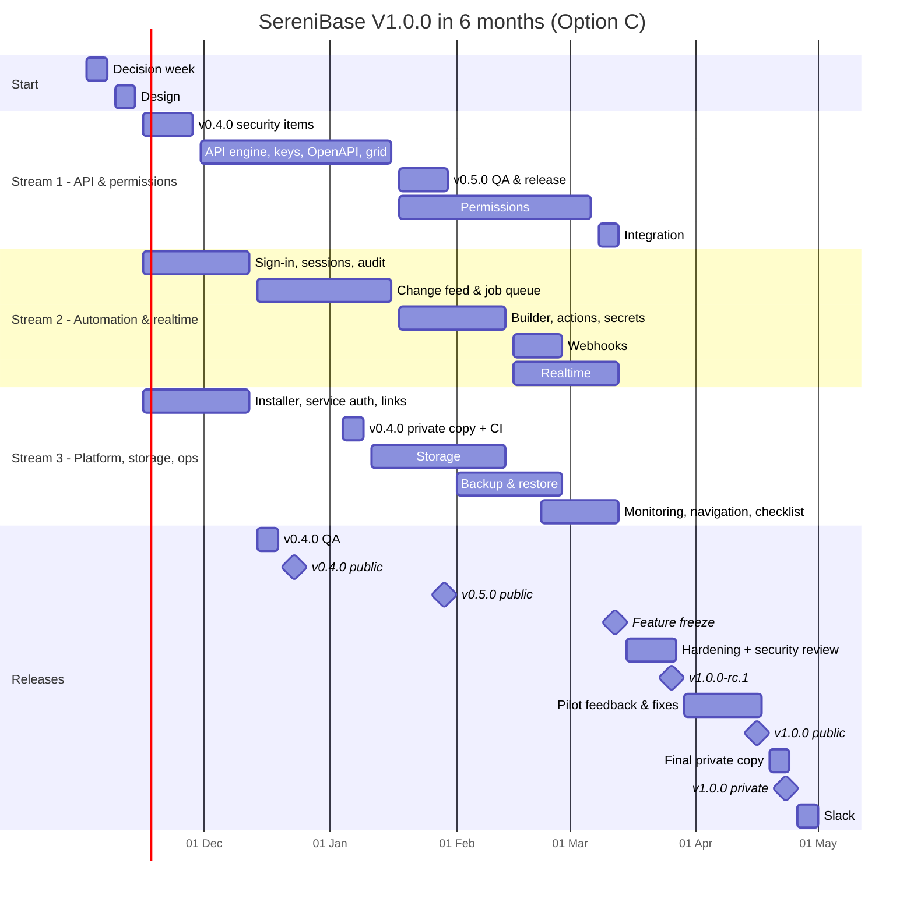

# SereniBase — V1.0.0 in 6 Months (Nov 2026 → Apr 2027)

**Created:** 2026-10-30 · **Status:** Option C adopted as the working plan. Sign-off on **scope** (§3) and **team** (§4) still needed by Fri 13 Nov 2026
**Target:** V1.0.0 in the private repo by **Fri 30 Apr 2027**

> **This is the decision record:** why the plan changed and which options were considered. The plan itself now lives in:
> - [RELEASE_PLAN_V1.md](RELEASE_PLAN_V1.md) — scope per release
> - [RELEASE_TIMELINE.md](RELEASE_TIMELINE.md) — schedule, team, meetings, QA, docs, private-repo copy, checkpoints
> - [FEATURE_STATUS.md](FEATURE_STATUS.md) — the Release column for every feature
>
> If this document and those differ, those win.

---

## 1. The short answer

**All 115 open features cannot be delivered in 6 months.** Even with AI tools, the current team needs about 17 months. Adding people cannot close a gap that large: new people take weeks to become productive, coordination grows, and much of the work has to happen in order (APIs → permissions → workflows and realtime).

**A smaller V1.0.0 can ship in 6 months if all five of these happen:**

1. **Cut V1.0.0 to the core of the V1.0.0 flow:** 81 of the 115 open features. The other 34 move to V1.1 (§3).
2. **Add 3 developers and 1 QA engineer by the end of November 2026** (§4).
3. **Everyone uses AI tools** (Claude Code or similar), with the setup and review rules from [RELEASE_TIMELINE.md §8.2](RELEASE_TIMELINE.md).
4. **3 parallel work streams and 3 releases instead of 7** (§5–§6). Fewer releases means fewer stabilisation cycles.
5. **Changes are copied to the private repo every sprint**, not in one batch per release (§7).

**Result:** public `v1.0.0` on **Fri 16 Apr 2027**, private repo on **Fri 23 Apr 2027**. That leaves one week of slack before 30 Apr.

**Risk: high.** There is only one week of slack. Late hiring, late decisions, or many security-review findings will move the date. §9 lists the checkpoints where we find out early, and the features we drop first if we must.

---

## 2. Options

| Option | What it means | V1.0.0 in private repo | Features at V1.0.0 | Verdict |
|---|---|---|---|---|
| **A. Full scope + AI** | Current team of 8, all 115 features ([RELEASE_TIMELINE.md §10](RELEASE_TIMELINE.md)) | Fri 31 Mar 2028 | 115 / 115 | Misses the target by about 11 months. |
| **B. Current team, deeper cut** | Team of 8 + AI. Also drops realtime, storage buckets and file browser, saved API connections, and extra monitoring. | End of Apr 2027 | ≈ 68 / 115 | Possible, but very high risk. Storage and realtime steps of the V1.0.0 flow are missing. |
| **C. Core scope + bigger team** ✅ *recommended* | Team of 12 + AI, 3 streams | **Fri 23 Apr 2027** | **81 / 115** | Achievable with high risk. Covers every step of the V1.0.0 flow except environments and custom code. |
| **D. Full scope + much bigger team** | About 25+ people | — | 115 / 115 | Not realistic. Hiring and onboarding alone take most of the 6 months. |

The rest of this document describes **Option C**.

---

## 3. Scope for a 6-month V1.0.0

### 3.1 Summary

| | Features |
|---|---:|
| Already done today | 25 |
| **Delivered by Apr 2027** | **81** |
| Moved to V1.1 | 34 + backlog B2 |
| **V1.0.0 complete** | **106 of 140 (76%)** |

**Product decision needed:** the release plan says V1.0.0 is done when *all 140 features are ✅*. For the 6-month plan, V1.0.0 is defined as the 106 features above, and the rest becomes the first V1.1 release (§11).

### 3.2 What stays, by area

| # | Area | Open | Kept | Moved to V1.1 |
|---|---|---:|---:|---|
| 1 | Project & Workspace Management | 6 | 2 | 1.2, 1.3, 1.5, 1.7 |
| 2 | Visual Data Modeling | 7 | 2 | 2.4, 2.6, 2.8, 2.11, 2.12 |
| 3 | Automatic API Generation | 10 | **10** | — |
| 4 | Authentication & Authorization | 11 | **11** | — |
| 5 | No-Code Workflow Builder | 9 | **9** | — |
| 6 | Custom Business Logic | 8 | 0 | 6.1 – 6.8 (all) |
| 7 | Integrations & Webhooks | 9 | 8 | 7.4 |
| 8 | Admin & Data Management UI | 7 | 2 | 8.11, 8.12, 8.13, 8.14, 8.15 |
| 9 | Realtime & File Storage | 12 | 10 | 9.10, 9.13 |
| 10 | Developer Experience | 11 | 5 | 10.4, 10.5, 10.6, 10.7, 10.9, 10.12 |
| 11 | Deployment & Operations | 8 | 6 | 11.2, 11.7 |
| 12 | Security & Reliability | 11 | **11** | — |
| 13 | User Experience | 6 | 5 | 13.6 |
| | **Total** | **115** | **81** | **34** |

### 3.3 What moves to V1.1, and why it is safe

| Group | Features | Why it can wait |
|---|---|---|
| **Environments and config-as-code** | 1.3, 1.7, 6.8, 7.4, 10.5, 10.12, 11.2, 11.7 | One environment per installation works for V1. Needs project export first, which is also moved. |
| **Custom business logic** | 6.1 – 6.7 | Workflows and webhooks cover most needs. This is also the riskiest security area, so moving it **makes the security review smaller**. |
| **SQL editor and schema tools** | 2.4, 2.6, 2.8, 2.11, 2.12, 10.4, 10.9, B2 | Data modeling already works. Direct foreign keys, the diagram, review/history, and the SQL editor are improvements, not flow blockers. |
| **Project database connection** | 1.5, 10.7 | The built-in database works. P7 already planned connection details for v1.0.0 only. |
| **Data-screen extras** | 8.11, 8.12, 8.13, 8.14, 8.15, 13.6 | Bulk edit, linked-record jump, Excel/JSON import, dashboard, mobile screens. CSV import exists today. |
| **Other** | 1.2, 9.10, 9.13, 10.6 | Settings pages, file-metadata screen, storage usage, CLI. The TypeScript SDK already exists. |

Several moved features are the same work counted twice (for example 2.12 and 10.9), so the actual V1.1 work is smaller than 34.

### 3.4 Delivered in a simpler form

| Feature | Full plan | 6-month version |
|---|---|---|
| 5.1 Visual workflow editor | Drag-and-drop canvas | **Step-by-step list builder** (trigger → conditions → actions). The canvas comes in V1.1. |
| 3.7 / 10.11 API tester | Custom in-app tester | **Swagger UI "Try it out"** on each project's generated OpenAPI spec. |
| 7.1 – 7.3 External API connections | Separate Connections screen | URL, headers, and API key / Bearer token set **inside the HTTP action**, using the secret store. |
| B1 One-click install | Install, upgrade with automatic rollback, uninstall | Install and upgrade, with a **settings backup and a documented manual rollback**. Automatic rollback in V1.1. |
| 11.5, 11.9, 11.10 Monitoring | Metrics, Grafana dashboard, status page | Metrics endpoint plus a **service-status page** in the admin UI. Grafana in V1.1. |
| 1.6, 13.1 Setup wizard and onboarding | Guided wizard and tour | A **"next steps" checklist** in new projects. |
| 9.7 File browser | Full browser | Upload, download, view, and delete per bucket. Folders and bulk actions in V1.1. |

### 3.5 The V1.0.0 flow after the cut

| # | Step | In the 6-month V1.0.0? |
|---|---|:---:|
| 1 | Create workspace | ✅ |
| 2 | Create project | ✅ (checklist, not a wizard) |
| 3 | Configure database | 🟡 built-in database only |
| 4 | Model data | ✅ (indexes added; diagram and history in V1.1) |
| 5 | Manage records | ✅ (fast on large tables) |
| 6 | Configure authentication & permissions | ✅ |
| 7 | Generate APIs | ✅ |
| 8 | Build workflows | ✅ (list builder) |
| 9 | Configure integrations | ✅ (webhooks + HTTP action) |
| 10 | Enable realtime & storage | ✅ |
| 11 | Test | ✅ |
| 12 | Deploy | 🟡 one-command install, backup, monitoring; no dev/prod environments |

---

## 4. Team needed

| Role | Today (assumed) | Needed | Change |
|---|---:|---:|---|
| Product owner / BA | 1 | 1 | — (must be available daily for decisions) |
| Tech lead | 1 | 1 | — |
| Backend | 2 | **4** | +2 (one senior who leads the Automation stream) |
| Frontend | 2 | **3** | +1 |
| Platform / DevOps | 1 | 1 | — (also owns the private-repo copy) |
| QA | 1 | **2** | +1 test-automation engineer |
| **Total** | **8** | **12** | **+4** |

- **New people must start by Mon 30 Nov 2026** to be productive by mid-December. That is only realistic with **contractors or internal transfers**. Normal hiring takes longer.
- **If they have not started by Mon 7 Dec 2026, switch to Option B scope.**
- AI tool seats and usage for all 12 people (check current pricing).
- External security review: **book the vendor in week 1** for 15 – 26 Mar 2027.

---

## 5. Three parallel streams

| Stream | People | v0.4.0 work (wk 3–6) | Then |
|---|---|---|---|
| **1. Core API & permissions** | Tech lead, 2 backend, 1 frontend | Restricted SQL role, rate and size limits, transactions, scoped automation guard (12.2, 12.4, 12.6, 12.10) | Query engine and per-project API, keys, exposure settings, validation, indexes, server-side grid, column resize, OpenAPI + tester, SDK and MCP updates → **v0.5.0**. Then custom roles, table/row/field rules, public access, auth settings. |
| **2. Automation & realtime** | Senior backend (stream lead), 1 backend, 1 frontend | Sign-up, OTP, server-side logout, token revocation, password rehash, audit log, activity feed (1.4, 4.1–4.3, 12.1, 12.5) | Change feed and job queue, workflow builder, conditions, actions, run history, retries, secret store, webhooks, then realtime with SDK subscriptions. |
| **3. Platform, storage & ops** | Platform, 1 frontend, shared backend help | B1 installer, service-to-service auth, jwt-provider fixes, signed URLs, migration runner, health checks (9.11, 11.3, 11.8) | Private-repo copy every sprint, storage buckets, policies and file browser, backup and restore, metrics and status page, navigation, next-steps checklist, help messages. |
| **QA** | 2 QA | Auth and installer tests | QA 1 tests stories in each sprint. QA 2 builds the **end-to-end flow test** from week 3 and the **permission matrix test** from week 11. |

**Where the streams depend on each other**

- Realtime (stream 2), file policies (stream 3), and permission checks in workflows all need the row and field rules from stream 1. Streams 2 and 3 build against an agreed permission interface from week 2 and connect to the real rules in **week 18**.
- The change feed (stream 2) is needed by both workflows and realtime. It must be done by mid-January.

---

## 6. Schedule

| Week | Dates | What happens |
|---|---|---|
| 1 | 2 – 6 Nov | **Decision week** (§8). Scope and team sign-off, AI tool policy, book the security review, set up the private-repo copy process. |
| 2 | 9 – 13 Nov | **Design:** v0.4.0 security design, query engine + permission interface, change feed + job queue. Wireframes for API keys, permissions, workflow builder, file browser. |
| 3 – 6 | 16 Nov – 11 Dec | **v0.4.0 development** (all streams). Stream 1 starts the query engine in week 5. |
| 7 | 14 – 18 Dec | v0.4.0 QA. |
| 8 | 21 – 23 Dec | **v0.4.0 public release — Wed 23 Dec 2026.** |
| — | 24 Dec – 1 Jan | Year-end break. |
| 9 | 4 – 8 Jan | v0.4.0 copied to the private repo (first time, with CI setup) — **private Fri 8 Jan 2027.** |
| 9 – 10 | 4 – 15 Jan | Stream 1 finishes the API. Stream 2 finishes the change feed and queue. Stream 3 starts storage. |
| 11 – 12 | 18 – 29 Jan | v0.5.0 QA and fixes. **v0.5.0 public release — Fri 29 Jan 2027** (generated APIs, keys, docs, fast grid). Stream 1 starts permissions. |
| 13 | 1 – 5 Feb | v0.5.0 in the private repo (small, because sprint copies already happened). |
| 13 – 17 | 1 Feb – 5 Mar | Permissions (S1), workflows + webhooks (S2), storage + backup (S3). Sprint builds go to a **pilot environment** for selected users. |
| 18 | 8 – 12 Mar | Integration week: rules connected to realtime, files, and workflows. **Feature freeze Fri 12 Mar 2027.** Anything unfinished moves to V1.1. |
| 19 – 20 | 15 – 26 Mar | **Launch hardening:** full end-to-end test, permission matrix, load test, upgrade chain v0.3.0 → v1.0.0, backup/restore drill, **external security review**, docs finished. **`v1.0.0-rc.1` Fri 26 Mar 2027.** |
| 21 – 22 | 29 Mar – 9 Apr | Pilot users test the RC. Fix bugs and security findings. |
| 23 | 12 – 16 Apr | Final fixes, go/no-go. **`v1.0.0` public release — Fri 16 Apr 2027.** |
| 24 | 19 – 23 Apr | Final private-repo copy and private-side QA (upgrade chain + backup drill). **Private `v1.0.0` — Fri 23 Apr 2027.** |
| 25 | 26 – 30 Apr | **Slack** (the only buffer in the plan). |

---

## 7. How each kind of work changes in a 6-month plan

| Work | Full plan | 6-month plan |
|---|---|---|
| **Requirement gathering** | Workshops before each of 7 releases | **One decision week** (§8) for everything, then a 30-minute stakeholder checkpoint each week. Rule: any open question is answered within 2 working days, or the tech lead's recommendation applies. |
| **Design** | Per release | One design week for the three core designs. Smaller designs happen inside sprints. |
| **Development** | 7 releases in sequence | 3 streams in parallel. AI tools for code, tests, SDK and MCP updates. 2-week sprints. |
| **Code review** | Human review | AI first pass, then a person reviews every PR. The tech lead reviews all auth, permissions, SQL, and secrets code. |
| **QA** | A stabilisation phase per release | **Continuous testing in every sprint** plus automation from week 3. Only one long QA phase: launch hardening (weeks 19–20). |
| **Documentation** | Per release | Part of "done" for each story; AI drafts, people review. Docs finished by Fri 26 Mar. The docs set is smaller (no environments, CLI, or custom code). |
| **Private-repo copy** | Once per release (about 1–1.5 weeks each) | **Every sprint** by the platform engineer with AI tools (about 1 day per sprint). Release copies are small, except the first (week 9) and the last (week 24). |
| **Security review** | v0.9.0 | Weeks 19–20 on the frozen build. Smaller scope because custom code and the SQL editor have moved to V1.1. |
| **UAT / pilot** | Per release + 2-week RC cycle | Pilot users on the sprint builds from February, plus a 2-week RC cycle. |

---

## 8. Decision week (2 – 6 Nov 2026)

All decisions the 6-month scope depends on must be made this week. Decisions for moved features (P3, P6, P7, P8, P9) wait for V1.1.

| Day | Session | Decisions |
|---|---|---|
| Mon | **Scope & team sign-off** (stakeholders, 3 h) | Option C, the 106-feature V1.0.0 definition, hiring/contractors, AI tool budget. |
| Mon | **AI tools & private repo** (1 h) | Which tools, whether AI may read the private repo, review rules. Private-repo copy process and owner. |
| Tue | Security & install (2 h) | Audit fixes, **P1** sign-up policy, **E1** image registry, installer scope (§3.4). |
| Wed | APIs (2 h) | **P2** API naming, key scopes, filter syntax contract (shared with SDK and MCP owners). |
| Wed | Permissions (2 h) | **P4** public access default, **E2** where rules are enforced, the permission interface other streams build against, data-leak path list. |
| Thu | Automation & realtime (2 h) | **E3** job queue, **E4** change feed, **E5** WebSocket, list builder design, retry policy, webhook format. |
| Thu | Storage (1 h) | **P5** what a bucket is, file policies, signed-link lifetime. |
| Fri | Planning (2 h) | Streams, sprint 1 backlogs, checkpoints (§9). **Book the security review.** Recruit pilot users. |

---

## 9. Checkpoints and what we drop first

### 9.1 Checkpoints

| Date | Must be true | If not |
|---|---|---|
| Fri 13 Nov 2026 | Scope and team signed off. AI tool policy approved. Security review booked. | The 30 Apr date is not achievable. Re-plan. |
| Mon 30 Nov 2026 | All 4 new people started. | By 7 Dec: switch to Option B scope. |
| Wed 23 Dec 2026 | v0.4.0 released. | Move realtime to V1.1 (first item in §9.2). |
| Fri 29 Jan 2027 | v0.5.0 released. Change feed and queue working. | Drop the next items in §9.2 until the plan fits. |
| Fri 5 Mar 2027 | Permissions done. Workflows and webhooks done. | Drop the next items in §9.2. |
| Fri 12 Mar 2027 | Feature freeze. | Unfinished features move to V1.1. **No exceptions.** |
| Fri 9 Apr 2027 | No open high-risk security findings. | Use the slack week. GA moves to Fri 23 Apr, private repo to Fri 30 Apr. |

### 9.2 Drop order (agreed in advance)

If the plan slips, drop these in this order so nobody has to argue under pressure:

1. Realtime (9.1 – 9.5)
2. Webhook test screen (7.9), and auth options in the HTTP action beyond API key (7.2 – 7.3)
3. File browser beyond upload/download (9.7), keeping private files and secure links
4. Monitoring beyond the metrics endpoint (11.9, 11.10)
5. Column resize (8.8) and the next-steps checklist (13.9)

**Never dropped:** the security fixes, permissions (4.5 – 4.9, 12.7, 12.8), file security (9.8, 9.9, 9.11, 12.9), backup and restore (11.4), and the upgrade test.

---

## 10. Risks

| Risk | Impact | What we'll do |
|---|---|---|
| New people don't start by end of November | Not enough capacity | Contractors or internal transfers. Fall back to Option B on 7 Dec. |
| Stakeholders don't accept the scope cut | Target impossible | Show Option A's date (Mar 2028) and get a decision in week 1. |
| Only one week of slack | Any slip moves the date | The checkpoints and drop order in §9. |
| Streams 2 and 3 depend on the permission rules | Integration problems late | Agree the permission interface in week 2. Integration week 18. Permission matrix tests from week 11. |
| Security review finds serious issues late (weeks 19–20) | Fix time is short | Smaller review scope. AI-assisted security review on every PR. Slack week as a reserve. |
| AI-written code adds subtle bugs | Quality problems after launch | Human review of every PR, tests first for security code. Plan a `v1.0.1` in May with someone on call. |
| AI tools not allowed on the private repo | About 1 extra day per sprint for the platform engineer | Copy with patch files by hand. Platform engineer's storage work shifts to the stream 3 frontend and shared backend. |
| Year-end break inside the plan | Less time in December | v0.4.0 released on 23 Dec. Nothing planned for 24 Dec – 1 Jan. |
| Tired team after 6 months at full speed | Mistakes, people leaving | No planned overtime. Scope is cut instead. |

---

## 11. After V1.0.0

**V1.1.0 (complete the original V1 list):** the 34 moved features, plus B2 and the full versions of the features in §3.4. With a team of 12 and AI tools, that takes **about 3 months**: public around **Fri 23 Jul 2027**, private repo around **Fri 30 Jul 2027**.

The roadmap versions have moved one step later: the old V1.1.0 – V1.7.0 are now V1.2.0 – V1.8.0 in [FEATURE_STATUS.md](FEATURE_STATUS.md).
