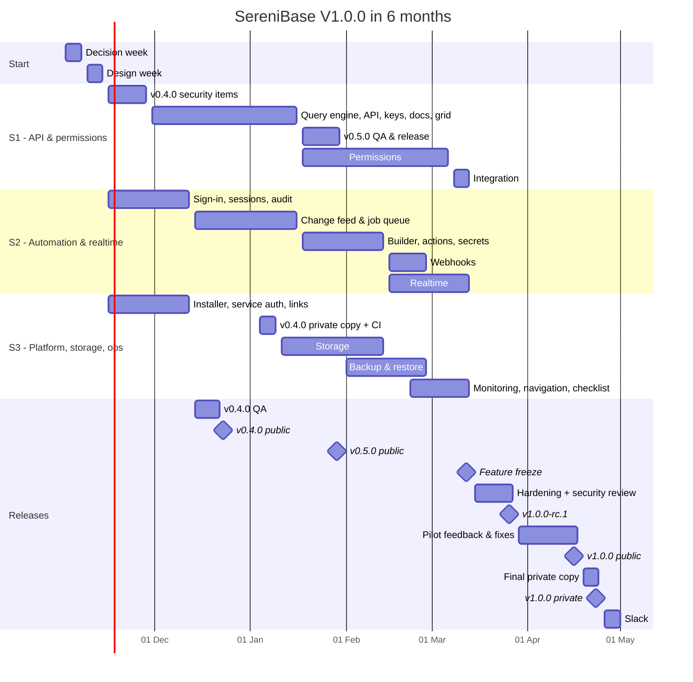

# SereniBase — Release Timeline & Effort (v0.4.0 → v1.0.0 → V1.1.0)

**Updated:** 2026-10-30. Re-planned so V1.0.0 ships within 6 months
**Scope per release:** [RELEASE_PLAN_V1.md](RELEASE_PLAN_V1.md) · **Status:** [FEATURE_STATUS.md](FEATURE_STATUS.md) · **Options and reasons:** [RELEASE_PLAN_6_MONTHS.md](RELEASE_PLAN_6_MONTHS.md)
**Status of this estimate:** plan of record once scope and team are signed off (Fri 13 Nov 2026). Re-check at every sprint review.

The release plan says *what* ships. This document says *when*, *who*, and *how*. It counts all the work, not only coding:

- requirement gathering and decision meetings
- design (UX and technical)
- development and code review
- QA
- documentation
- UAT, pilot, and release
- **manual copy of every change to the private repository**
- contingency

---

## 1. Summary

| Version | What | Public release | Private repo |
|---|---|---|---|
| **v0.4.0** | Security, sign-in & one-command install (13 + B1) | Wed 23 Dec 2026 | Fri 8 Jan 2027 |
| **v0.5.0** | Generated APIs & a faster data grid (16) | Fri 29 Jan 2027 | Fri 5 Feb 2027 |
| **v1.0.0** | Permissions, automation, storage, realtime & launch (52) | **Fri 16 Apr 2027** (rc.1 Fri 26 Mar) | **Fri 23 Apr 2027** |
| *Slack* | The only buffer before the deadline | | 26 – 30 Apr 2027 |
| **V1.1.0** | Complete the V1 list (34 + B2) | ≈ Fri 23 Jul 2027 | ≈ Fri 30 Jul 2027 |

**Key points**

- **25 working weeks** from Mon 2 Nov 2026 to Fri 30 Apr 2027, with **one week of slack**. Risk is **high**. The checkpoints in §9 show early if the date is slipping.
- **Team of 12** (today 8) in **three parallel streams**, all using AI tools (§3, §8). The 4 new people must start by **Mon 30 Nov 2026**.
- **All requirements are gathered in one decision week** (2 – 6 Nov), not before each release (§7.1).
- **QA runs in every sprint,** with automation from week 3. The only long QA phase is launch hardening (15 – 26 Mar).
- **Changes are copied to the private repo every sprint.** Only the final copy (19 – 23 Apr) is on the critical path (§6).
- **Feature freeze is Fri 12 Mar 2027, with no exceptions.** Unfinished features move to V1.1.0 in the agreed order.

---

## 2. Assumptions

| Area | Assumption |
|---|---|
| **Team** | 12 people (§3). Developers write their own unit and integration tests. No dedicated technical writer; AI drafts docs and people review them. |
| **AI tools** | Everyone uses Claude Code or a similar tool, set up in decision week (§8.2). Savings are already counted in the dates. |
| **Rhythm** | 2-week sprints, 5-day weeks. Sprint 1 starts Mon 16 Nov 2026. |
| **Start** | Monday 2 Nov 2026. |
| **Holidays** | Year-end break 24 Dec 2026 – 1 Jan 2027. Regional holidays and leave are **not** included. With only one week of slack, plan leave carefully and record it in the team calendar now. |
| **Accuracy** | About ±20% through v0.5.0, about ±30% for v1.0.0 work. That is why the split order exists. |
| **Repositories** | The public repos (`aptlogica/*`) are the source of truth. Changes are copied **by hand** to the private repo(s). Nobody develops in the private repo, except emergency hotfixes, which are copied back the same day. |
| **Scope rule** | Anything not finished at feature freeze moves to V1.1.0. Dates do not move to fit scope. |

---

## 3. Team and streams

| Role | Today | Needed | Change |
|---|---:|---:|---|
| Product owner / BA | 1 | 1 | — (must be available daily for decisions) |
| Tech lead | 1 | 1 | — (leads S1; reviews all security-sensitive code) |
| Backend | 2 | **4** | +2 (one senior who leads S2) |
| Frontend | 2 | **3** | +1 |
| Platform / DevOps | 1 | 1 | — (leads S3; owns the private-repo copy) |
| QA | 1 | **2** | +1 test-automation engineer |
| **Total** | **8** | **12** | **+4** |

- New people need contractors or internal transfers to start by **30 Nov 2026**. If they have not started by **7 Dec**, switch to the smaller scope (Option B in [RELEASE_PLAN_6_MONTHS.md](RELEASE_PLAN_6_MONTHS.md)).
- AI tool seats and usage for all 12 (check current pricing).
- **Book the external security review in week 1** for 15 – 26 Mar 2027.

| Stream | People | v0.4.0 (weeks 3–6) | After v0.4.0 |
|---|---|---|---|
| **S1 — Core API & permissions** | Tech lead, 2 backend, 1 frontend | Restricted SQL role, rate and size limits, transactions, scoped automation guard | **v0.5.0:** query engine, per-project API, keys, docs, grid, indexes. **v1.0.0:** roles, table/row/field rules, public access, auth settings, schema validation. |
| **S2 — Automation & realtime** | Senior backend (lead), 1 backend, 1 frontend | Sign-up, OTP, logout, token revocation, rehash, audit log, activity feed | **v1.0.0:** change feed and queue, workflows, HTTP action, secrets, webhooks, realtime. |
| **S3 — Platform, storage & ops** | Platform (lead), 1 frontend, shared backend help | B1 installer, service-to-service auth, jwt-provider fixes, signed URLs, migration runner, health checks | Private-repo copy every sprint. **v1.0.0:** storage, backup/restore, monitoring, navigation, checklist, help messages. |
| **QA** | 2 | Auth and installer tests | QA 1 tests every story in its sprint. QA 2 builds the **end-to-end flow test** (from week 3) and the **permission test** (from week 11). |

**Dependencies between streams**
- S2 and S3 need the permission rules from S1. They build against the agreed **permission interface** (E6) from week 2, using a stub, and connect to the real rules in **integration week (8 – 12 Mar)**.
- Workflows, webhooks, and realtime all need the **change feed** (S2). It must be working by **Fri 15 Jan 2027**.

---

## 4. Schedule

| Week | Sprint | Dates | What happens |
|---|---|---|---|
| 1 | — | 2 – 6 Nov | **Decision week** (§7.1). |
| 2 | — | 9 – 13 Nov | **Design week:** v0.4.0 security design, query engine + permission interface, change feed + job queue. Wireframes for API keys, permissions, workflow builder, file browser. Private-side CI and registry setup starts. **Scope and team sign-off Fri 13 Nov.** |
| 3 – 4 | 1 | 16 – 27 Nov | v0.4.0 development (all streams). |
| 5 – 6 | 2 | 30 Nov – 11 Dec | v0.4.0 development; S1 starts the query engine. New people join. **v0.4.0 code freeze Fri 11 Dec.** |
| 7 – 8 | 3 | 14 – 23 Dec | v0.4.0 QA and fixes. **v0.4.0 public — Wed 23 Dec.** S2 starts the change feed. |
| — | — | 24 Dec – 1 Jan | Year-end break. |
| 9 – 10 | 4 | 4 – 15 Jan | **v0.4.0 copied to the private repo (first time) — Fri 8 Jan.** S1 finishes the API; S2 finishes the change feed and queue; S3 starts storage. **v0.5.0 code freeze Fri 15 Jan.** |
| 11 – 12 | 5 | 18 – 29 Jan | v0.5.0 QA and fixes. **v0.5.0 public — Fri 29 Jan.** S1 starts permissions. S2 builds the workflow builder and actions. |
| 13 – 14 | 6 | 1 – 12 Feb | **v0.5.0 in the private repo — Fri 5 Feb.** Permissions, workflows + secrets, storage, backup. Sprint builds go to a **pilot environment**. |
| 15 – 16 | 7 | 15 – 26 Feb | Permissions, webhooks, realtime, backup, monitoring. |
| 17 – 18 | 8 | 1 – 12 Mar | **Permissions done Fri 5 Mar.** **Integration week 8 – 12 Mar.** **Feature freeze Fri 12 Mar.** |
| 19 – 20 | — | 15 – 26 Mar | **Launch hardening + external security review.** Docs finished. **`v1.0.0-rc.1` Fri 26 Mar.** |
| 21 – 22 | — | 29 Mar – 9 Apr | Pilot users test the RC. Fix bugs and security findings. V1.1.0 workshops (§7.5). |
| 23 | — | 12 – 16 Apr | Final fixes, go/no-go. **`v1.0.0` public — Fri 16 Apr.** |
| 24 | — | 19 – 23 Apr | Final private-repo copy and private-side QA. **Private `v1.0.0` — Fri 23 Apr.** |
| 25 | — | 26 – 30 Apr | **Slack.** |

---

## 5. How each kind of work is done

| Work | How it runs in this plan | Who |
|---|---|---|
| **Requirement gathering** | All V1.0.0 decisions in **decision week** (§7.1). Smaller requirement workshops happen inside sprints (listed per version in §7). A 30-minute **stakeholder checkpoint every week**. Rule: any open question is answered within 2 working days, or the tech lead's recommendation applies. | PO, tech lead, stream leads, QA |
| **Design** | One design week (week 2) for the three core designs: security, query engine + permission interface, change feed + queue. Other designs happen in the sprint before the work. Wireframes are reviewed in backlog refinement. | Tech lead, stream leads, frontend |
| **Development** | 3 streams in parallel. 2-week sprints. AI tools for code, tests, SDK and MCP updates. Feature flags for risky changes (server-side grid). | Developers |
| **Code review** | AI first pass, then a person reviews every PR. The tech lead reviews all auth, permissions, SQL, and secrets code. Small PRs. | Developers, tech lead |
| **QA** | Every story is tested in its own sprint. Automation from week 3: the end-to-end flow test and, from week 11, the permission test, both run on every change. A short QA and fix window before each release. Only one long QA phase: launch hardening. | QA 1, QA 2, developers fixing |
| **Documentation** | Part of "done" for every story. AI drafts, people review. Docs are finished by rc.1 (Fri 26 Mar). | Developers, PO |
| **UAT / pilot** | Sprint demo every 2 weeks. Pilot users on the sprint builds from February. Two weeks of RC feedback. | PO, stakeholders, pilot users |
| **Release** | Go/no-go, tag, publish images through the installer, release notes, upgrade notes. | Platform, PO, QA |
| **Private-repo copy** | Every sprint (§6). | Platform engineer + QA smoke test |
| **Contingency** | No per-release buffer. Instead: the split order, the feature-freeze rule, and the slack week. | — |

### Meetings

| Meeting | How often | Length | Who |
|---|---|---|---|
| Stand-up per stream | Daily | 15 min | Each stream |
| Cross-stream sync | Twice a week | 15 min | Stream leads, QA |
| Interface sync (permission interface, change feed) | Weekly | 45 min | Tech lead, stream leads |
| Stakeholder checkpoint | Weekly | 30 min | PO, tech lead, stakeholders |
| Backlog refinement | Weekly per stream | 1 h | PO, stream lead, QA |
| Sprint planning | Every 2 weeks | 2 h | Whole team |
| Sprint review / demo | Every 2 weeks | 1 h | Team, stakeholders, pilot users from Feb |
| Retrospective | Every 2 weeks | 45 min | Whole team |
| Private-repo copy check | Every 2 weeks | 30 min | Platform, QA |
| Go / no-go | Once per release | 30 min | PO, tech lead, QA, platform |

---

## 6. Private repository copy

Every change is copied by hand from the public repos to the private repo(s). It is real work, it can introduce bugs, and it has to be tested again on the private side.

### 6.1 Steps (for every copy)

1. **Freeze:** tag the public sprint build or release in every repo touched.
2. **List the changes:** per repo, the commits and files changed since the last copy (`git log` / `git diff --stat <last-copied-tag>..<new-tag>`).
3. **Port:** apply the changes in dependency order: shared libraries (`go-postgres-rest`, `base-sdk`) first, then services, then `sereni-base`, then `base-ui`.
4. **Reconcile what differs on the private side:**
   - private-only changes and conflicts;
   - module paths and package names (Go `go.mod`, npm scope and registry);
   - CI pipelines, container registry, and CI secrets;
   - `.env` defaults and environment settings.
5. **Database migrations:** copy migration files **exactly, in the same order, never edited**. The v0.4.0 migration runner depends on this.
6. **Build and test on the private side:** CI green, QA smoke test, and the upgrade from the previous private build.
7. **Tag and record:** tag the private build and update `MIGRATION_LOG.md` (public SHA → private SHA, manual edits, and why).

### 6.2 When it happens and what it costs

| Copy | When | Effort | On critical path? |
|---|---|---|---|
| Private CI and registry setup | Weeks 2 – 8, alongside v0.4.0 work | ~3 days | No |
| **v0.4.0** (first copy, 7 repos + CI) | Week 9 (4 – 8 Jan) | 1 week | No (v0.5.0 work continues) |
| Sprint 4 – 8 copies | End of each sprint | ~1 day + ½ day QA each | No |
| **v0.5.0** | Week 13 (by Fri 5 Feb) | 2 – 3 days | No |
| **v1.0.0** (final, all repos) | Week 24 (19 – 23 Apr) | 1 week, incl. upgrade chain and backup drill on the private side | **Yes** |
| **Total** | | **≈ 4 weeks of effort**, mostly by the platform engineer | Only the last week |

If AI tools are not allowed on the private repo (P11), add about **1 day per sprint**.

### 6.3 Rules

| Practice | Why |
|---|---|
| **Copy every sprint**, not every release. | Small batches mean fewer conflicts and no surprise at the end. |
| **One owner:** the platform engineer, with QA for the smoke test. | Clear responsibility. Nothing gets missed. |
| **A migration log** in the private repo. | Anyone can check what was copied and spot drift. |
| **A checklist** (the 7 steps above), stored as a reusable AI command. | Makes the manual work repeatable. |
| **No feature work in the private repo.** Hotfixes there are copied back the same day. | Keeps the two from drifting apart. |
| **Use patch files where policy allows** (`git format-patch` / `git am`). | Keeps history and makes copying errors much less likely. |
| **Never copy secrets or keys.** The private side generates its own JWT secret, secret-store master key, and signing keys. | Shared keys would be a security incident. |

---

## 7. Versions in detail

### 7.1 Decision week (2 – 6 Nov 2026) — all of V1.0.0

| Day | Session | Decisions and outputs |
|---|---|---|
| Mon | **Scope & team sign-off** (stakeholders, 3 h) | **P10** 106-feature V1.0.0, hiring/contractors, AI tool budget. |
| Mon | **AI tools & private repo** (1 h) | **P11**, tool list, review rules, private-repo copy process and owner. |
| Tue | **Security & install** (2 h) | Audit walkthrough with all developers: fix and test for each issue. **P1** sign-up, **E1** image registry, installer scope (manual rollback). |
| Tue | **Activity feed & file links** (1 h) | Which actions are audited and who sees them; signed-link lifetime; how long old links work. |
| Wed | **APIs** (2 h) | **P2** API naming, key scopes and service role, filter syntax (shared with SDK and MCP owners), performance target (1M rows < 1 s). |
| Wed | **Permissions** (2 h) | **P4** public access default, **E2** where rules are enforced, **E6** permission interface, first version of the data-leak path list. |
| Thu | **Automation & realtime** (2 h) | **E3** job queue, **E4** change feed, **E5** WebSocket, list builder concept, retry policy, webhook payload and signing. |
| Thu | **Storage & ops** (1 h) | **P5** what a bucket is, file policies, backup expectations (acceptable data loss, restore time). |
| Fri | **Planning** (2 h) | Streams, sprint 1 backlogs, checkpoints (§9). **Book the security review.** Start recruiting pilot users. |

---

### 7.2 v0.4.0 — Security, sign-in & one-command install

**Public:** Wed 23 Dec 2026 · **Private:** Fri 8 Jan 2027
**Repos touched:** `sereni-base`, `base-ui`, `base-sdk`, `sereni-jwt-provider`, `sereni-storage-provider`, `sereni-email-smtp`, `sereni-antivirus-clamav`, plus CI/release workflow and installer scripts

| Phase | Weeks | Dates |
|---|---:|---|
| Requirements (decision week) | 1 | 2 – 6 Nov |
| Design | 1 | 9 – 13 Nov |
| Development (sprints 1–2) | 4 | 16 Nov – 11 Dec |
| QA and fixes | 1.5 | 14 – 22 Dec |
| Release | — | Wed 23 Dec |
| Private-repo copy | 1 | 4 – 8 Jan |

**Requirement meetings:** all in decision week (Tue sessions).

**QA focus**
- An automated regression test for **every audit issue**.
- Auth flows end to end, including failure cases: sign-up, verify, login, logout, reset. Revoked tokens rejected everywhere. Reuse of an old refresh token detected.
- Existing users' passwords are rehashed on next login without lockouts.
- Installer matrix: clean Linux, macOS, and Windows with only Docker. Upgrade from v0.3.0. The documented manual rollback works.
- Migration runner on a real v0.3.0 database.
- After the link rewrite, existing attachments, avatars, and project images still display.
- Internal services reject calls without credentials.

**Documentation:** install / upgrade / uninstall / rollback guide for three OSes; sign-up and verification admin guide; upgrade notes (users logged out once, file links change, passwords rehashed); changelog for v0.2.0 – v0.4.0; corrected `base-ui` README; ADR for E1; developer note on versioned migrations.

**Private-repo copy:** the widest spread of repos and the first copy, so it takes a full week. Set up private CI and registry during weeks 2 – 8 so week 9 is only porting and testing. From now on, migration files are copied exactly and in order.

**Watch-outs:** QA runs right before the break. Code freeze Fri 11 Dec is firm; anything late moves to v0.5.0.

---

### 7.3 v0.5.0 — Generated APIs & a faster data grid

**Public:** Fri 29 Jan 2027 · **Private:** Fri 5 Feb 2027 · stream **S1**
**Repos touched:** `sereni-base`, `base-ui`, `base-sdk`, `go-postgres-rest`, `sereni-base-mcp-server`

| Phase | Weeks | Dates |
|---|---:|---|
| Requirements (decision week) | — | 4 Nov (Wed sessions) |
| Design | 1 | 9 – 13 Nov (query engine, routing, keys, OpenAPI) |
| Development | 5 working weeks | 30 Nov – 15 Jan (sprints 2–4, around the break) |
| QA and fixes | 2 | 18 – 29 Jan |
| Release | — | Fri 29 Jan |
| Private-repo copy | 2 – 3 days | by Fri 5 Feb |

**Requirement meetings (in sprints):** grid rollout plan — feature flag and when to switch (1 h, sprint 2); API keys screen review (30 min, sprint 3).

**QA focus**
- API contract tests for every verb, filter, sort, paging, `fields`, and `expand`. Unknown and read-only fields rejected.
- API key scopes; revoked keys stop working. Batch writes are all-or-nothing.
- **Performance test** on a 1M-row table; the browser never downloads the whole table.
- Grid behaves the same with the flag on and off.
- Generated OpenAPI passes a linter, updates after a table change, and "Try it out" works with a key.
- SDK test suite against the new API. MCP server regression.

**Documentation:** public API getting-started (keys, CRUD by table name, filter syntax, paging, errors), SDK reference update, index guide, ADR for P2.

**Private-repo copy:** the `go-postgres-rest` version bump must match (`go.mod` version or `replace`); SDK publishing to the private registry if there is one; same feature-flag defaults on both sides.

**Watch-outs:** if the query engine is late by mid-January, use the split point — docs and tester, indexes, and column resize move into v1.0.0.

---

### 7.4 v1.0.0 — Permissions, automation, storage, realtime & launch

**Feature freeze:** Fri 12 Mar 2027 · **rc.1:** Fri 26 Mar · **Public:** Fri 16 Apr · **Private:** Fri 23 Apr
**Repos touched:** all repos

| Phase | Weeks | Dates |
|---|---:|---|
| Requirements | — | Decision week + in-sprint workshops below |
| Development | 8 – 13 working weeks, depending on stream | S2: 14 Dec – 12 Mar · S3: 11 Jan – 12 Mar · S1: 18 Jan – 12 Mar |
| Integration week | 1 | 8 – 12 Mar |
| Launch hardening + external security review | 2 | 15 – 26 Mar |
| RC pilot feedback and fixes | 2 | 29 Mar – 9 Apr |
| Final fixes and GA | 1 | 12 – 16 Apr |
| Final private-repo copy | 1 | 19 – 23 Apr |
| Slack | 1 | 26 – 30 Apr |

**Requirement workshops (in sprints)**

| When | Workshop | Stream |
|---|---|---|
| Sprint 3 | Workflow list builder UX; action and app-event list (2 h) | S2 |
| Sprint 4 | Storage UX: buckets, file browser (1 h) | S3 |
| Sprint 4 | Permission model with real customer scenarios (2 × 2 h); final data-leak path inventory (2 h) | S1 |
| Sprint 5 | Secret-store key management; failure and retention policy (1 h) | S2 |
| Sprint 5 | Auth settings: password rules, session length (1 h) | S1 |
| Sprint 6 | Monitoring metrics and status page; next-steps checklist content (1 h) | S3 |
| Sprint 6 | Realtime subscription rules and limits (1 h) | S2 |
| Sprint 7 | Launch readiness: docs list, pilot group, API freeze, load-test targets (1.5 h) | All |

**QA focus**
- **Permission test:** every role × table × action × row rule × field rule. UI, API, and SDK give the same answer. Every path in the leak inventory has a test.
- Anonymous visitors see only what the public policy allows. A private file can't be opened without permission, even with its link.
- Workflows end to end: "when Status becomes Closed, call this API" runs within seconds. External API down → retries → failed with full error → re-run. **Restart the server mid-run — no lost work.**
- Webhook signatures verify; "send test" shows what was sent and received. Secrets never appear in the UI or logs.
- Realtime: a change shows in another browser within about 1 second, and **never** to a user who can't see it.
- Backup and restore drill. Load test for API and workflow throughput.
- **Upgrade chain v0.3.0 → v1.0.0** with real data, on both sides.
- Retest every security-review finding after its fix.

**Documentation:** guides for permissions (with examples), public access (with warning), storage, auth settings, workflows, webhooks (with signature-checking examples), secrets, realtime SDK, backup and restore runbook, monitoring, self-hosting, upgrading from v0.3.0. Known limitation: raw SQL triggers bypass row and field rules.

**Private-repo copy:** large DB migrations (roles, rules, outbox, `jobs`, `workflow_runs`, buckets). The private side **generates its own secret-store master key**. WebSocket proxy settings and storage configuration must be checked on the private side. The final copy includes the full upgrade chain and a backup drill on the private side.

**Watch-outs**
- Integration week is the riskiest week in the plan. The weekly interface sync from week 2 keeps the stub and the real rules aligned.
- The RC pilot needs users lined up by February.

---

### 7.5 V1.1.0 — Complete the V1 list

**Public:** ≈ Fri 23 Jul 2027 · **Private:** ≈ Fri 30 Jul 2027 · team of 12 with AI tools

| Phase | Weeks | Dates |
|---|---:|---|
| Requirements | — | Workshops during the RC pilot (29 Mar – 9 Apr): **P3** SQL editor, **P6** function language, **P7** project DB connection, **P8** environments, **P9** guided triggers, export format versioning |
| `v1.0.1` hotfixes + design | 1 | 3 – 7 May |
| Development | 7 | 10 May – 25 Jun |
| QA + external security review (custom code, SQL editor) | 2 | 28 Jun – 9 Jul |
| Contingency | 1 | 12 – 16 Jul |
| Release | 1 | 19 – 23 Jul |
| Private-repo copy | 1 | 26 – 30 Jul |

**QA focus:** export → import round trip; promote dev → prod differences; sandbox abuse (endless loop, memory, file access); SQL editor read-only mode and permissions; guided-trigger SQL with unusual names; Excel/JSON import edge cases; responsive screens on real devices.

**Watch-outs:** book the second security review in March. Reserve capacity in May for `v1.0.1` fixes — each fix also goes to the private repo.

---

## 8. AI tools

### 8.1 Where AI helps and where it doesn't

| Work | Time saved | How AI helps | What stays with people |
|---|---:|---|---|
| Requirements | 0–20% | Drafts user stories and acceptance criteria from FEATURE_STATUS gaps; lists edge cases; turns meeting notes into decision records. | The decisions. |
| Design | ~25% | Searches the codebase for impact; drafts ADRs, migrations, API contracts. | Final design, especially security. |
| Development | 20–40% | Code and tests, refactors across many files, keeping SDK and MCP in step. | Architecture, review of every change. |
| Code review | — | First-pass review (for example Claude Code `/code-review` and `/security-review`). | A person approves every PR. |
| QA | 20–25% | Test cases, contract and E2E scripts, large datasets, permission-matrix combinations. | Exploratory and usability testing, sign-off. |
| Documentation | ~50% | First drafts from code, OpenAPI, and PRs; changelogs and release notes. | Accuracy and wording. |
| Private-repo copy | 40–50% | Change lists, applying changes, fixing paths and config, running tests, writing the log. | Reviewing the port, private-side QA. |
| UAT, pilot, security review | ~0% | Checklists and notes. | People's and vendors' calendars set the pace. |

### 8.2 Setup (decision and design weeks)

- **Approval and policy:** which tools and which repos, including the private repo (P11). Never put secrets, keys, or customer data in prompts.
- **Project instructions in every repo** (a `CLAUDE.md` for Claude Code): build and test commands, conventions, areas that need extra review.
- **Reusable commands:** private-repo copy checklist, release notes, FEATURE_STATUS update.
- **Review rules:** AI first pass, then human review on every PR. Extra review for auth, permissions, SQL, and secrets code. Small PRs.
- **Measure:** compare planned vs actual per sprint and adjust the split order early.

### 8.3 Best uses per version

| Version | Where AI helps most | Where to be careful |
|---|---|---|
| v0.4.0 | A regression test per audit issue; middleware refactors; installer scripts for three OSes and the CI matrix; changelog from git history. | Token, password, and signed-URL code — reviewed line by line. |
| v0.5.0 | CRUD handlers and validation from column metadata; runtime OpenAPI generator; SDK and MCP updates; contract tests; 1M-row data generator. | The query compiler (SQL injection) — add fuzz tests. |
| v1.0.0 | **Codebase sweep for the data-leak path inventory**; permission-matrix tests; list builder and run-history screens; failure-injection tests; realtime SDK client; backup scripts; metrics wiring; docs. | Rule injection in the query engine, outbox/queue concurrency, realtime filtering, restore correctness — people design them, tests prove them. |
| V1.1.0 | ERD and canvas screens; Excel/JSON parsers; CLI; guided-trigger SQL tests; sandbox abuse tests. | Sandbox escapes and SQL editor restrictions. |

### 8.4 Risks

| Risk | What to do |
|---|---|
| Subtle bugs or security holes in generated code | Human review of every change; tests first for security code. |
| Review becomes the bottleneck | Small PRs, AI first-pass review, rotating reviewers. |
| Private code or secrets sent to an outside service | Written policy, approved tools only, no secrets in prompts. |
| Made-up libraries or functions | CI on every PR, committed lockfiles, dependency review. |
| Savings lower than assumed | Measured every sprint; the split order absorbs the difference. |

---

## 9. Checkpoints and drop order

### 9.1 Checkpoints

| Date | Must be true | If not |
|---|---|---|
| Fri 13 Nov 2026 | Scope (P10) and team signed off. AI policy (P11) approved. Security review booked. | 30 Apr is not achievable. Re-plan. |
| Mon 30 Nov 2026 | All 4 new people started. | By 7 Dec: switch to the smaller scope (Option B). |
| Wed 23 Dec 2026 | v0.4.0 released. | Drop item 1 below. |
| Fri 15 Jan 2027 | Change feed and queue working. | Drop item 1 below. |
| Fri 29 Jan 2027 | v0.5.0 released. | Drop the next items below until the plan fits. |
| Fri 5 Mar 2027 | Permissions done. Workflows and webhooks done. | Drop the next items below. |
| Fri 12 Mar 2027 | Feature freeze. | Unfinished features move to V1.1.0. **No exceptions.** |
| Fri 9 Apr 2027 | No open high-risk security findings. | Use the slack week: GA Fri 23 Apr, private Fri 30 Apr. |

### 9.2 Drop order (agreed in advance)

1. Realtime (9.1 – 9.5)
2. Webhook test screen (7.9), and HTTP-action auth beyond API key (7.2 – 7.3)
3. File browser beyond upload/download (9.7)
4. Monitoring beyond the metrics endpoint (11.9, 11.10)
5. Column resize (8.8) and the next-steps checklist (13.9)

**Never dropped:** the security fixes, permissions (4.5 – 4.9, 12.7, 12.8), file security (9.8, 9.9, 9.11, 12.9), backup and restore (11.4), and the upgrade test.

---

## 10. Reference: full scope in 7 releases (not chosen)

Kept so the decision can be checked later. Same 140-feature list, all of it in V1.0.0, team of 8.

| | Without AI tools | With AI tools |
|---|---|---|
| Releases | v0.4.0 – v0.9.0, v1.0.0 | same |
| Working weeks | 93 | 72 |
| V1.0.0 public | Wed 16 Aug 2028 | Fri 24 Mar 2028 |
| V1.0.0 in private repo | Fri 25 Aug 2028 | Fri 31 Mar 2028 |
| Private-repo copy effort | 9 weeks | 6 weeks |

Main lessons carried into this plan:
- Coding was only about half of each release. Per-release stabilisation, kickoff, and migration overheads add up across 7 releases.
- Requirement gathering can run ahead of development instead of before each release.
- The platform engineer was idle in several releases. That is why S3 now owns the private-repo copy, storage, and ops work.

---

## 11. Keeping this current

- At every **sprint review**, compare planned vs done per stream and check the next checkpoint in §9.
- Track **private-repo copy time** on its own. If a sprint copy takes more than 2 days, find out why before the next sprint.
- Record how much the AI tools actually save. Replace the percentages in §8.1 after v0.5.0.
- Update the dates here and the Release column in [FEATURE_STATUS.md](FEATURE_STATUS.md) whenever scope moves.
